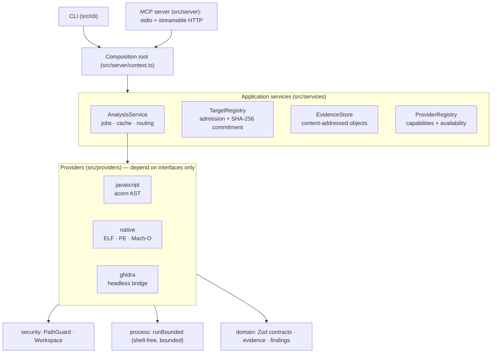

<div align="center">

# Vestige

**Evidence-driven reverse engineering for AI agents.**

An open, independent MCP platform that lets compatible AI coding agents inspect authorized
software artifacts, investigate their structure, and produce **verifiable, evidence-linked**
technical reports.

[](.github/workflows/ci.yml)
[](docs/COMPATIBILITY.md)
[](tsconfig.json)
[](https://modelcontextprotocol.io)
[](LICENSE)

</div>

---

## Why Vestige

Most analysis tools answer questions. Vestige answers questions **with receipts**: every claim
an agent makes about a binary or application is backed by a content-addressed evidence record
that is re-authenticated whenever it is read. Accuracy is treated as a measurable engineering
objective — benchmarks run against deterministic fixtures with embedded ground truth, and the
results ship in [`docs/BENCHMARKS.md`](docs/BENCHMARKS.md) only after actually running.

Vestige is an independent project — inspired by the engineering patterns of
[morluto/rea](https://github.com/morluto/rea) (MIT), but with its own architecture,
implementation, identity, and test suite. See
[`docs/ASSESSMENT-REA.md`](docs/ASSESSMENT-REA.md) for the full reference assessment and the
improvement matrix that motivated this design.

## Quick start

```bash
# Requires Node.js >= 20.19 (tested on 24.x)
npm install
npm run build
npm test          # 137+ tests: unit, integration, security, regression, e2e

# Register a target and analyze it via the CLI
node dist/cli/main.js register ./path/to/app --label "sample app"
node dist/cli/main.js providers
node dist/cli/main.js analyze <artifactId> --provider javascript
node dist/cli/main.js findings <artifactId>
node dist/cli/main.js doctor
```

### MCP client configuration

**stdio (recommended for local agents):**

```json
{
  "mcpServers": {
    "vestige": {
      "command": "node",
      "args": ["/absolute/path/to/vestige/dist/cli/main.js", "mcp"],
      "env": {
        "VESTIGE_DATA_DIR": "/absolute/path/to/vestige-data",
        "VESTIGE_LOG_LEVEL": "info"
      }
    }
  }
}
```

**Streamable HTTP (opt-in, remote deployments):**

```bash
VESTIGE_HTTP_TOKEN=$(openssl rand -hex 32) \
VESTIGE_HTTP_HOST=0.0.0.0 VESTIGE_HTTP_PORT=8420 \
node dist/cli/main.js mcp --http
```

HTTP requires a bearer token for any non-loopback bind (constant-time compared), validates
`Host` headers against an allowlist (DNS-rebinding defense), and rejects disallowed `Origin`s.
Clients connect to `http://host:8420/mcp` with `Authorization: Bearer <token>`.

## What it can analyze (today, with tests)

| Provider | Formats | Capabilities | External tool? |
|---|---|---|---|
| `javascript` | JS/TS sources, directories, Electron apps | AST module graph (imports/exports/requires/dynamic), Electron IPC channels, express-style route inventory, manifest/dependency facts | No (in-process acorn) |
| `native` | ELF (32/64), PE (PE32/PE32+), Mach-O (incl. FAT) | Headers, sections, symbols/functions, PE imports & exports, Mach-O dylibs, strings with offsets | No (pure TypeScript) |
| `ghidra` | ELF, PE, Mach-O | Headless decompilation, function inventory, call graph | Yes — Ghidra 11.x + Java 21+ (optional; availability-checked with install guidance) |

Unsupported formats are rejected honestly: Vestige never advertises a capability it cannot
demonstrate. Provider availability is always queryable (`vestige_list_providers`,
`vestige doctor`) and includes actionable installation guidance.

## Evidence model

Every significant finding carries:

- **Finding ID** (`vf_…`) and **Evidence ID** (`ve_…`) — content-derived, tamper-checked on read
- **Target artifact ID + SHA-256** commitment taken at registration
- **Provider name/version** and external **tool version** when applicable
- **Method** used to obtain the observation, **timestamp**, and typed **location**
  (file offset / virtual address / artifact path / section)
- **Confidence class** with explicit semantics:
  `observed-fact` · `static-inference` · `runtime-observation` · `ai-interpretation` · `hypothesis`
- **Limitations** declared up front by the provider

Evidence is stored content-addressed; re-analysis of identical content is served from a
verified cache. Reports (markdown/JSON) are deterministic and reproducible.

## Safety by default

- **Explicit registration required** — nothing is analyzed unless the operator registered it
- **Read-only analysis** — original artifacts are never modified; generated files live in an isolated workspace
- **Canonical path validation** — `realpath` resolution, symlink policy, allowed-roots enforcement, traversal rejection
- **Never executes unknown targets** — runtime observation is not implemented in v0.1 by design; static analysis is preferred
- **Shell-free process execution** — argv arrays only, output caps, hard timeouts, SIGTERM→SIGKILL stop ladder, abort support
- **Central redaction** — logs and captured output pass a secret-scrubbing layer before persistence

See [`docs/THREAT-MODEL.md`](docs/THREAT-MODEL.md) and [`SECURITY.md`](SECURITY.md).

## Architecture (60-second tour)



Full details, module boundaries, and dependency rules: [`docs/ARCHITECTURE.md`](docs/ARCHITECTURE.md).

## Documentation

| Document | Contents |
|---|---|
| [`docs/ARCHITECTURE.md`](docs/ARCHITECTURE.md) | Modules, dependency direction, data flow |
| [`docs/MCP-CONTRACTS.md`](docs/MCP-CONTRACTS.md) | Tool/resource/prompt reference with schemas |
| [`docs/PROVIDERS.md`](docs/PROVIDERS.md) | Provider guides, Ghidra setup, troubleshooting |
| [`docs/THREAT-MODEL.md`](docs/THREAT-MODEL.md) | Assets, attackers, mitigations, residual risks |
| [`docs/BENCHMARKS.md`](docs/BENCHMARKS.md) | Measured accuracy & latency (from actual runs) |
| [`docs/COMPATIBILITY.md`](docs/COMPATIBILITY.md) | Tested vs intended platform support |
| [`docs/ASSESSMENT-REA.md`](docs/ASSESSMENT-REA.md) | Reference repository assessment & improvement matrix |
| [`SECURITY.md`](SECURITY.md) | Security policy and responsible use |
| [`CHANGELOG.md`](CHANGELOG.md) | Version history |
| [`CONTRIBUTING.md`](CONTRIBUTING.md) | Development workflow and quality gates |

## Verification status (this checkout)

The following were actually executed in the development environment (Linux x64, Node 24.22.1):

| Gate | Command | Result |
|---|---|---|
| Type check | `npm run typecheck` | ✅ pass (strict) |
| Build | `npm run build` | ✅ pass |
| Tests | `npm test` | ✅ 137 passed / 0 failed (unit 62, integration 17, security 12, regression 5, e2e 1, fixtures & parsers 40) |
| Benchmarks | `npm run bench:record` | ✅ recorded in `docs/BENCHMARKS.md` |

Platform notes: Windows and macOS are *intended* targets with platform-neutral code paths, but
only Linux was exercised in this checkout — see [`docs/COMPATIBILITY.md`](docs/COMPATIBILITY.md).

## License

MIT — see [LICENSE](LICENSE). Third-party notices: [THIRD_PARTY_NOTICES.md](THIRD_PARTY_NOTICES.md).
Vestige is not affiliated with, endorsed by, or an official release of the REA project.
